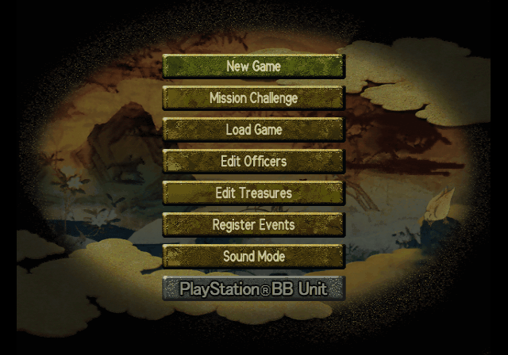
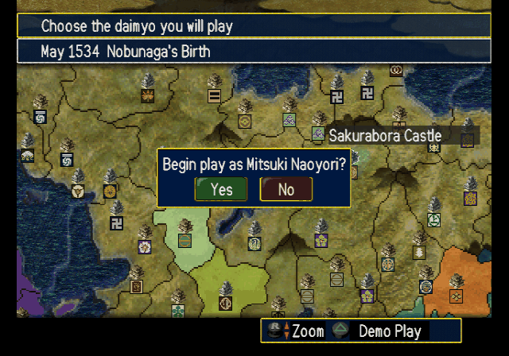
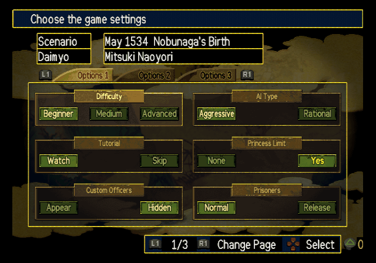
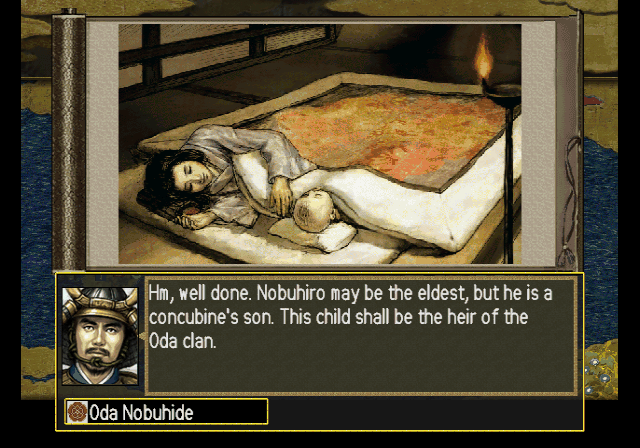
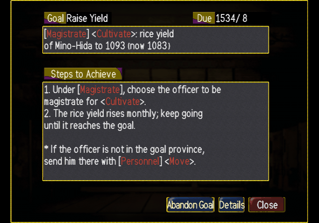
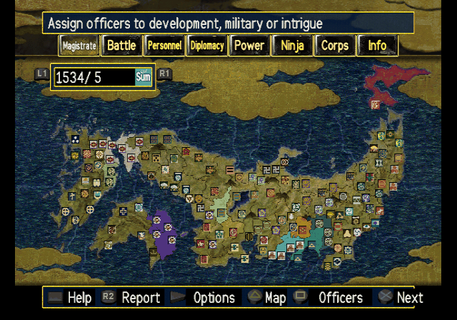
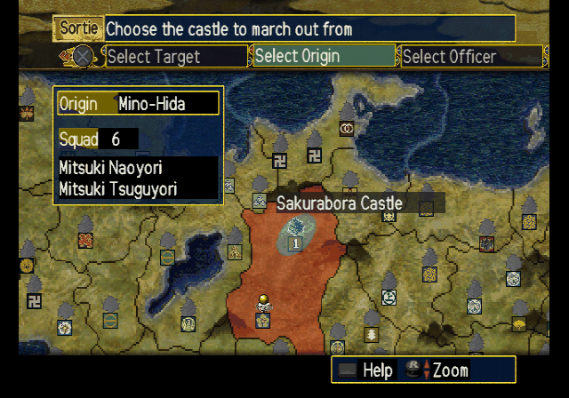
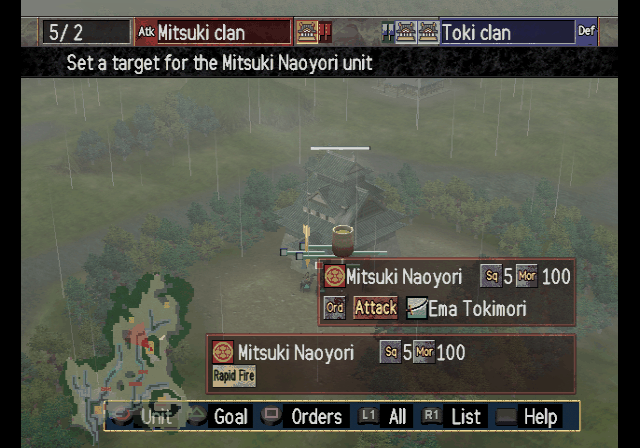
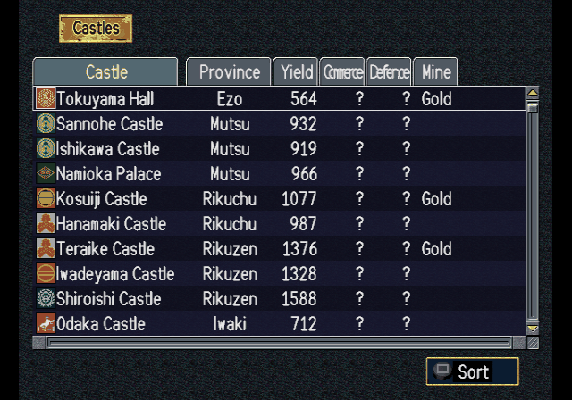

# Nobunaga no Yabou: Ranseiki with Power-Up Kit — English Translation

A fan translation of **Nobunaga no Yabou: Ranseiki with Power-Up Kit** (信長の野望・嵐世記
with パワーアップキット, Koei) for the PlayStation 2 into English. Ranseiki is the ninth
*Nobunaga's Ambition*: you lead a clan of the Sengoku period, set the course of your realm
with your officers in council, deal with the gentry, temples, ninja, pirates and merchant
towns that hold the land between the great houses, and unify Japan by diplomacy or by
war. The Power-Up Kit edition adds scenarios, a Mission Challenge mode, and editors for
officers, treasures and events. The game was only released in Japan.

> **This is a full machine translation.** All of the game's text was translated from
> Japanese by an AI model, not by a human translator, and it has not been
> proofread by a fluent Japanese speaker. Expect occasional mistranslations, awkward
> phrasing and inconsistent terms. Corrections are welcome.

> **This is a beta (v0.9.0).** All of the game's text is in English and the main screens
> have been played through, but not every battle result and mission screen has been seen
> yet. Expect some text that is squeezed, cut short or wrapped oddly.

This repository contains the English text and the tools that build the patch.
It does **not** contain the game, any of its data, or the Japanese script — you need
your own copy of the game.

## Screenshots

| | | |
|:-:|:-:|:-:|
|  |  |  |
| Main menu | Daimyo select | Game settings |
|  |  |  |
| Historical event | Council goal | Strategy map |
|  |  |  |
| Sortie | Battle | Castle list |

## What's translated

- All of the game's message text: advisor reports and council proposals, diplomacy,
  plots and war messages, historical and seasonal events, scenario introductions, help
  pages, the tutorial, missions, the Power-Up Kit editors, and memory card messages
- All officer biographies (about 1,500, plus the other heroes of the Power-Up Kit) and
  all 380 treasure names and descriptions
- Menus, labels, buttons and system messages, including the battle screens, the mission
  screens and the officer, treasure and event editors
- About 1,760 officer names, romanised (names shared with *Nobunaga no Yabou: Soutenroku*
  and *Taiko Risshiden V* use the same spelling), plus princesses, castles, provinces,
  clans, gentry, temples, ninja bands, navies, merchant towns, treasures, court titles,
  offices and the 15 scenario titles
- Graphics: title logo subtitle, main menu, command buttons, tabs, panel labels, map
  tags, battle labels, editor and mission labels, and the tutorial diagrams, redrawn at
  build time with an original English font
- A proportional English font

Long names and labels are shortened, or squeezed, where the game's boxes are too small.

## Applying the patch (players)

1. Download the release zip (`Nobunaga_no_Yabou_Ranseiki_PUK_English_v<version>.zip`)
   from the Releases page. It contains the patch,
   `nobunaga_ranseiki_puk_en_v<version>.xdelta`, and a .cue file for the patched image.
2. You need an unmodified image of the Japanese disc (serial `SLPM-62225`), in the
   usual single-track BIN/CUE form
   (`Nobunaga no Yabou - Ranseiki with Power-Up Kit (Japan).bin`):

   | | |
   |---|---|
   | Size  | 636,742,848 bytes |
   | CRC32 | `BF917C50` |
   | MD5   | `0c62796b63358bdd38e46a57f9a72587` |
   | SHA-1 | `29896216e810e511b466343441a238c89b3059ac` |

3. Apply it to the .bin with an xdelta tool, e.g.
   [Delta Patcher](https://github.com/marco-calautti/DeltaPatcher), or the command line:

   ```
   xdelta3 -d -s "Nobunaga no Yabou - Ranseiki with Power-Up Kit (Japan).bin" nobunaga_ranseiki_puk_en_v<version>.xdelta "Nobunaga no Yabou - Ranseiki with Power-Up Kit (English v<version>).bin"
   ```

4. Put the .cue from the zip next to the patched .bin. PCSX2 opens the .bin directly;
   other emulators may want the .cue.

The patched image has the same serial, so it uses the same memory card saves as the
Japanese game.

## Building from source

Requirements: Python 3.10+, `xdelta3` (for the patch file).

```
python -m venv .venv
.venv/bin/pip install -r requirements.txt
cp /path/to/your/disc.bin nobunaga_ranseiki_puk.bin   # must match the checksums above
.venv/bin/python tools/setup.py                       # extracts script/ from your disc, checks tl/
.venv/bin/python tools/build.py                       # writes build/nobunaga_ranseiki_puk_en.bin + .cue + .xdelta
```

`tools/setup.py` checks the disc's SHA-1 and generates `script/`, which pairs the
Japanese text from your disc with the English from `tl/`. `script/` and `build/` are
never committed. Re-run `setup.py` after editing anything in `tl/`.
The build is reproducible: the same disc and sources give a byte-identical patch.

To make a release package, run `.venv/bin/python tools/package.py 0.9.0` after building:
it writes `release/<name>_v0.9.0.zip` with the versioned xdelta patch, a .cue and a
plain-text README.txt. The disc image itself is never packaged.

## Repository layout

| Path | Contents |
|---|---|
| `tl/message/`, `tl/kretsu/` | English for the game's message file and the treasure texts, by entry number (`@N`) |
| `tl/elfstr/` | English for strings in the game program, by address |
| `tl/names/` | English names: officers, princesses, castles, provinces, clans, minor powers, treasures, titles, offices, scenario titles |
| `tl/gfx.txt` | Text drawn into graphics |
| `tools/setup.py`, `tools/build.py` | Create `script/`; build the patched disc and the patch |
| `tools/tl.py` | Validates and word-wraps translations (`apply`, `show`, `check`, `stats`) |
| `tools/iso.py`, `nb9.py`, `msgfile.py`, `msgscript.py`, `text.py` | CD image (MODE2 sectors with EDC/ECC), game archives and message formats |
| `tools/elfseg.py`, `elfstr.py`, `uifix.py`, `msgbuf.py`, `asm.py` | English data segment, program strings, layout and buffer fixes |
| `tools/vwf.py`, `latinfont.py` | Proportional font (original stroke drawings) and text measuring |
| `tools/names.py`, `namehook.py`, `scehead.py` | English names in the game, scenario titles |
| `tools/tim2.py`, `gfx.py` | Texture format and redrawn graphics |
| `tools/overflow.py` | Buffer limits: fails the build when text could overflow a fixed-size buffer in the game |
| `tools/package.py` | Makes the release zip (patch + .cue + README.txt with checksums) |
| `tools/dev/`, `tools/emu/` | Development helpers (disassembly, PCSX2 automation) |

## Known issues

- **Not every screen has been seen yet**: the results of a won battle (castle capture,
  prisoners), the Mission Complete screen, and the province markers of the Move command
  have not been checked and may show squeezed or cut labels. Reports with a screenshot
  are welcome.
- The award art on the Mission Complete screen stays in Japanese.
- In the tutorial's practice battle the stance screen may not accept a choice; answer
  No when the game offers a practice battle.
- If you see **thin lines next to letters when PCSX2 upscales**, open the game's
  Properties > Graphics, enable manual hardware fixes, and set **Round Sprite** to
  **Full** (in the Upscaling Fixes tab).
- Some labels are squeezed to fit narrow boxes, and many are abbreviated. A few long
  treasure names run past their title box.
- The 信長の野望 嵐世記 title art stays in Japanese.
- Name entry types English letters only; family and given names hold at most 8 letters (e.g. "Hachisuka" does not fit).
- Installing to the PlayStation 2 hard disk ("PlayStation BB Unit") has not been tested.

Tested in PCSX2 only. Bug reports with a screenshot and where it happened are welcome.

## Credits

- Translation and hacking: [damon-daemon](https://github.com/damon-daemon)
- Nobunaga no Yabou: Ranseiki with Power-Up Kit © Koei Tecmo. This is an unofficial fan
  project, not affiliated with or endorsed by Koei Tecmo. Please support the official
  releases.

## License

The tools, fonts, documentation and English translation text in this repository
are released under the [MIT License](LICENSE). This covers only original work in
this repository: the game itself and all of its content (code, Japanese text,
graphics, audio) are copyright Koei Tecmo and are not included or licensed here.
